# Succinate–Immune–Stromal Signaling in Crohn’s Disease

### A seven-state nonlinear ODE framework for fibrostenotic remodeling

This repository contains the Python/Jupyter implementation and numerical analyses of a mechanistic model investigating inflammatory, metabolic, immune, and stromal processes associated with fibrostenotic remodeling in Crohn’s disease.

The model brings together two proposed signaling routes:

1. **Succinate-associated route:** inflammatory activity → extracellular succinate → SUCNR1-associated signaling → FAP-positive fibroblast activity → ECM accumulation.
2. **Monocyte-associated route:** inflammatory activity → CD150-positive monocyte activity → TWIST1-associated activity → FAP-positive fibroblast activity → ECM accumulation.

Both routes converge additively at the fibroblast compartment. This represents a modeling assumption and does not imply a direct molecular interaction between SUCNR1-associated signaling and TWIST1.

## 1. Model structure

The system consists of seven state variables:

| Variable | Description |
|---|---|
| $I(t)$ | Inflammatory activity |
| $S(t)$ | Extracellular succinate |
| $R(t)$ | SUCNR1-associated signaling activity |
| $M(t)$ | CD150-positive inflammatory monocyte activity |
| $T(t)$ | TWIST1-associated activity |
| $F(t)$ | FAP-positive fibroblast activity |
| $C(t)$ | Extracellular matrix (ECM) burden |

The state vector is

$$
X(t)=[I(t),S(t),R(t),M(t),T(t),F(t),C(t)]^{\mathsf T}.
$$

### Model diagram

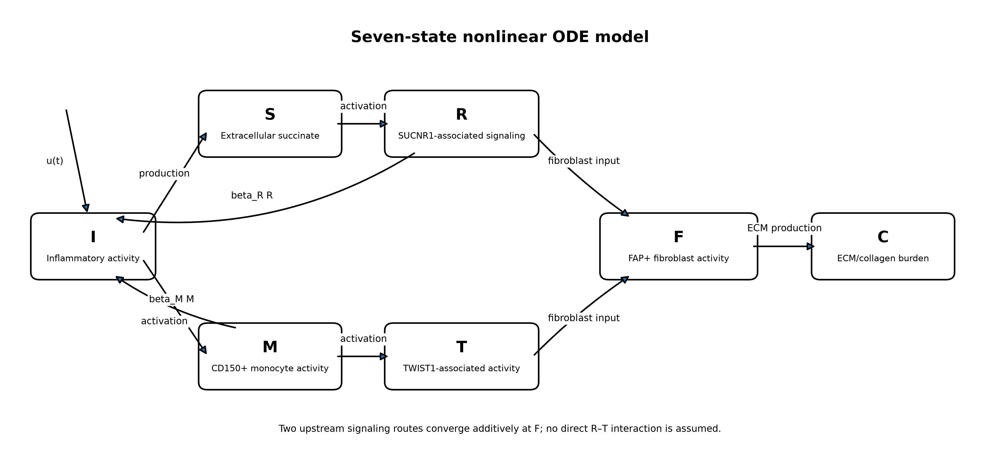

## 2. Mathematical formulation

The model is governed by the following nonlinear ODE system:

$$
\begin{aligned}
\frac{dI}{dt}
&=u(t)+\beta_RR+\beta_MM-\delta_I I,\\
\frac{dS}{dt}
&=p_SI-\delta_SS,\\
\frac{dR}{dt}
&=\alpha_R H(S;K_S)-\delta_RR,\\
\frac{dM}{dt}
&=\alpha_M H(I;K_I)-\delta_MM,\\
\frac{dT}{dt}
&=\alpha_T H(M;K_M)-\delta_TT,\\
\frac{dF}{dt}
&=\alpha_{FR}H(R;K_{FR})
+\alpha_{FT}H(T;K_{FT})-\delta_FF,\\
\frac{dC}{dt}
&=p_CF-\delta_CC.
\end{aligned}
$$

The saturating activation function is

$$
H(x;K)=\frac{x}{K+x}.
$$

Here, $u(t)$ represents an external inflammatory input. The state variables are normalized effective activities rather than absolute biological concentrations or cell counts. Time is measured in days.

## 3. Baseline parameters

| Parameter | Value | Interpretation |
|---|---:|---|
| $\beta_R$ | 0.03 | Feedback from $R$ to inflammation |
| $\beta_M$ | 0.03 | Feedback from $M$ to inflammation |
| $\delta_I$ | 0.50 | Inflammatory removal |
| $p_S$ | 0.40 | Succinate production |
| $\delta_S$ | 1.00 | Succinate removal |
| $\alpha_R$ | 0.60 | Activation of $R$ |
| $K_S$ | 0.50 | Succinate half-saturation |
| $\delta_R$ | 0.70 | Removal of $R$ |
| $\alpha_M$ | 0.50 | Activation of $M$ |
| $K_I$ | 0.50 | Inflammatory half-saturation |
| $\delta_M$ | 0.35 | Removal of $M$ |
| $\alpha_T$ | 0.45 | Activation of $T$ |
| $K_M$ | 0.50 | Monocyte half-saturation |
| $\delta_T$ | 0.25 | Removal of $T$ |
| $\alpha_{FR}$ | 0.35 | $R$-associated fibroblast input |
| $K_{FR}$ | 0.50 | Half-saturation for $R$ input |
| $\alpha_{FT}$ | 0.45 | $T$-associated fibroblast input |
| $K_{FT}$ | 0.50 | Half-saturation for $T$ input |
| $\delta_F$ | 0.12 | Fibroblast removal |
| $p_C$ | 0.25 | ECM production |
| $\delta_C$ | 0.025 | ECM removal |

**Parameter provenance:** These baseline values are exploratory modeling assumptions, not experimentally estimated biological constants. Published biological studies motivate the pathway structure, but do not provide direct estimates for every coefficient in this reduced seven-state system. Parameter ranges used in the uncertainty analysis are specified in the Jupyter notebook.

## 4. Equilibrium analysis

For the autonomous system, $u(t)=0$, the disease-free equilibrium is

$$
E_0=(0,0,0,0,0,0,0).
$$

The equilibrium conditions can be reduced to a scalar equation for $I^*$:

$$
g(I)=
\frac{\beta_R\alpha_R}{\delta_R}
H\left(\frac{p_SI}{\delta_S};K_S\right)
+
\frac{\beta_M\alpha_M}{\delta_M}H(I;K_I)
-\delta_I I=0.
$$

The corresponding model-specific feedback threshold is

$$
\mathcal{R}_{\mathrm{fb}}=
\frac{\beta_R\alpha_Rp_S}
{\delta_I\delta_R\delta_SK_S}
+
\frac{\beta_M\alpha_M}
{\delta_I\delta_MK_I}.
$$

This is a threshold derived from the present model, not an epidemiological reproduction number.

For positive parameter values, $g''(I)<0$ for $I>0$. The resulting equilibrium classification is:

- If $\mathcal{R}_{\mathrm{fb}}\leq 1$, the DFE is the only nonnegative equilibrium.
- If $\mathcal{R}_{\mathrm{fb}}>1$, the DFE remains present but is unstable, and a unique positive equilibrium exists.

The downstream variables $T$, $F$, and $C$ form a feed-forward cascade and contribute negative eigenvalues $-\delta_T$, $-\delta_F$, and $-\delta_C$ to the Jacobian. Under the stated model structure, the positive equilibrium is locally asymptotically stable.

## 5. Numerical experiments

The computational workflow is provided in `01_model_setup.ipynb`.

### Transient inflammatory response

A two-day inflammatory pulse with amplitude $0.2$ is applied, followed by a 60-day simulation.

For the baseline parameter set:

- Peak ECM burden: approximately **4.881**.
- Time to peak: approximately **31.90 days**.
- ECM burden at day 60: approximately **3.090**.

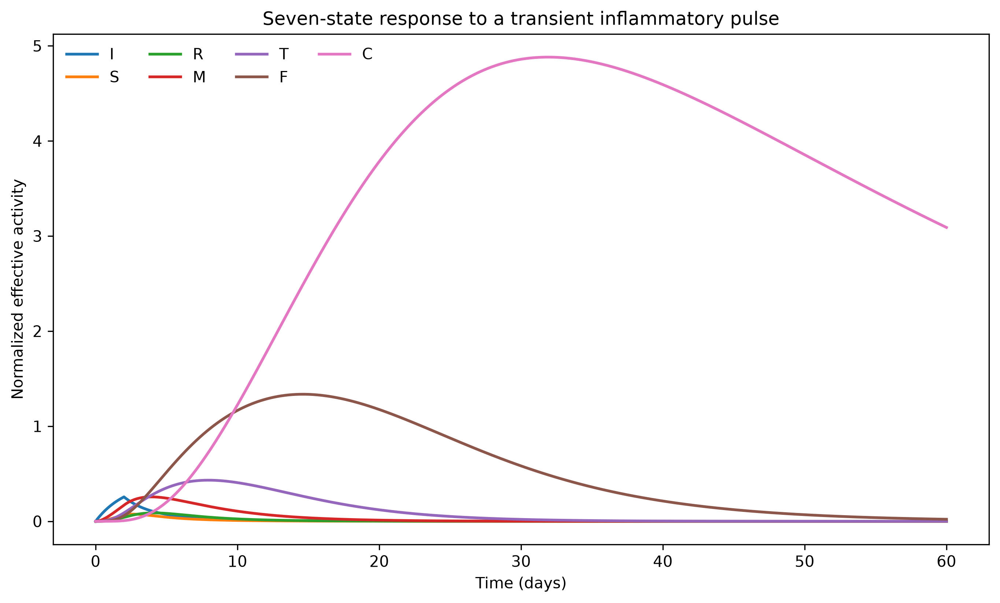

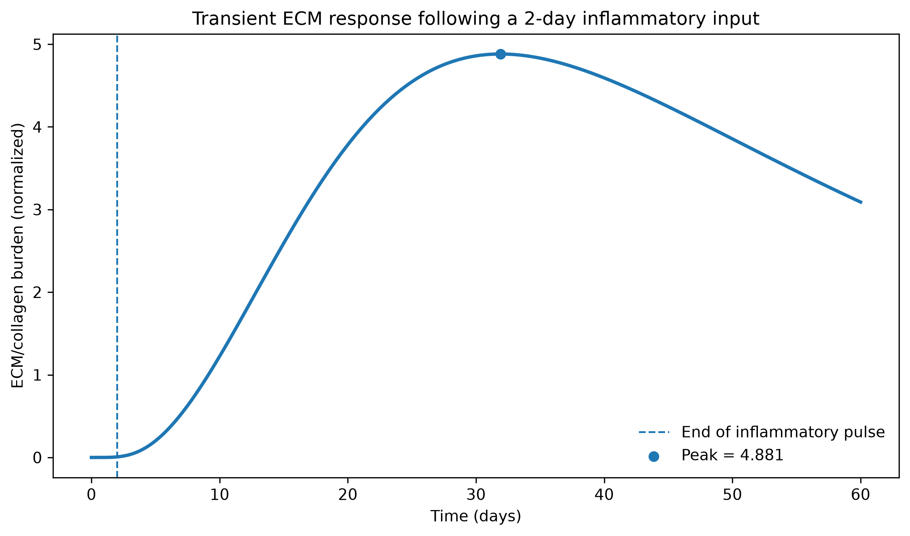

### Local sensitivity analysis

One-at-a-time (OAT) sensitivity analysis uses ±10% parameter perturbations to examine:

- Peak ECM burden.
- Final ECM burden.
- ECM area under the curve (AUC).
- Time to peak ECM.

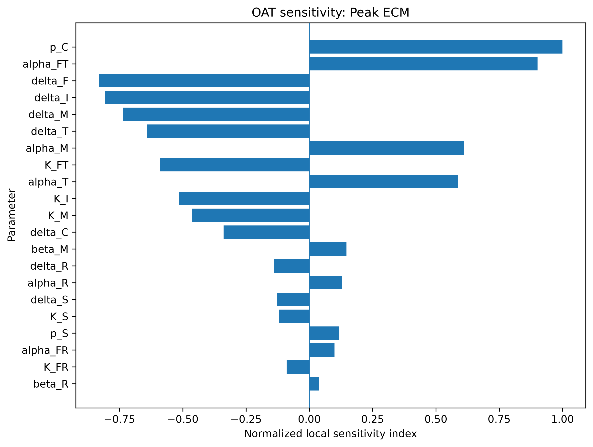

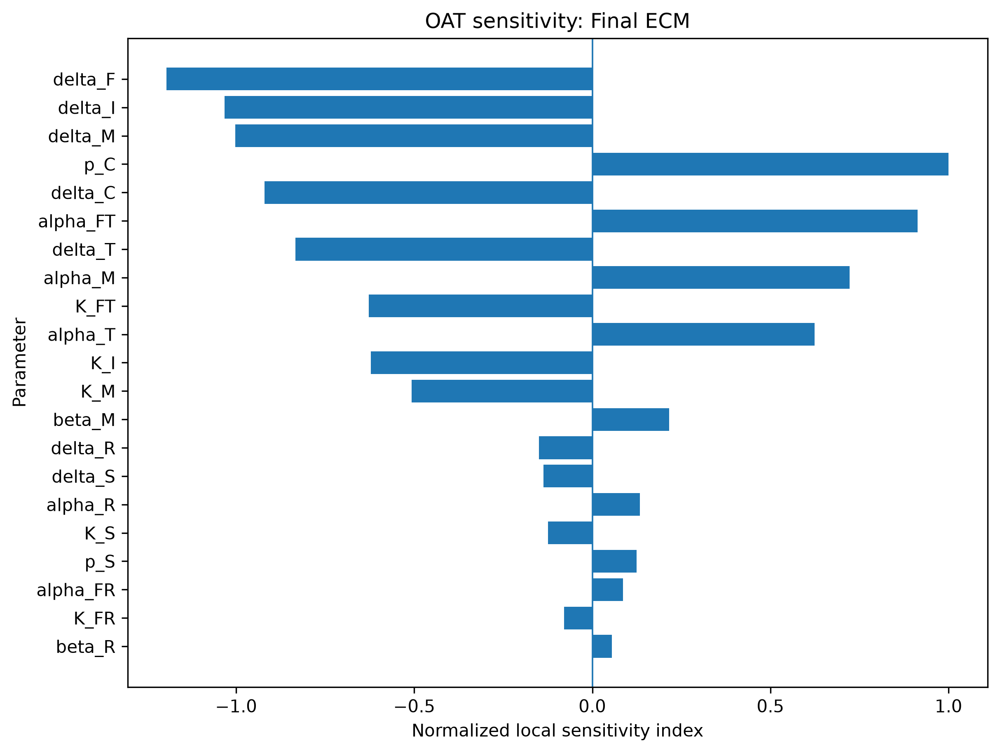

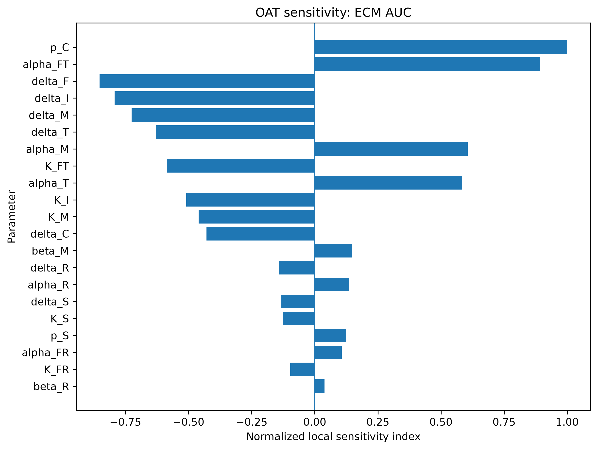

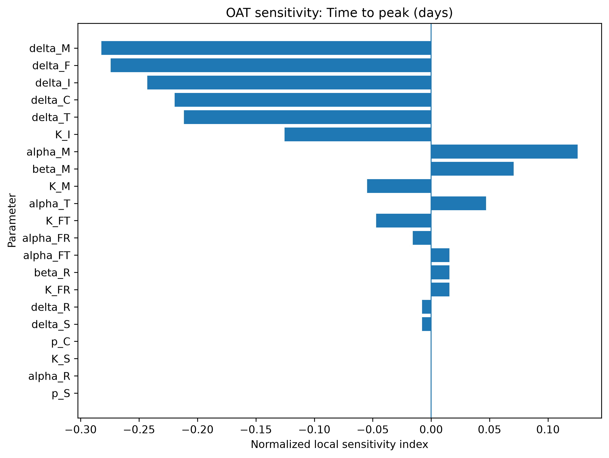

These indices describe local sensitivity around the baseline parameter set, not global parameter importance.

### Parameter uncertainty analysis

Latin hypercube sampling (LHS) was performed using 200 parameter sets and random seed `20261110`.

| Outcome | Median | 5th–95th percentile |
|---|---:|---:|
| Peak ECM | 1.751 | 0.121–23.677 |
| Final ECM | 0.905 | 0.026–23.677 |
| ECM AUC | 63.950 | 4.158–618.124 |
| Time to peak (days) | 30.325 | 17.848–60.000 |

These distributions are conditional on the selected parameter ranges and are not clinical confidence intervals. Peaks occurring at the simulation boundary are treated as horizon-limited observations.

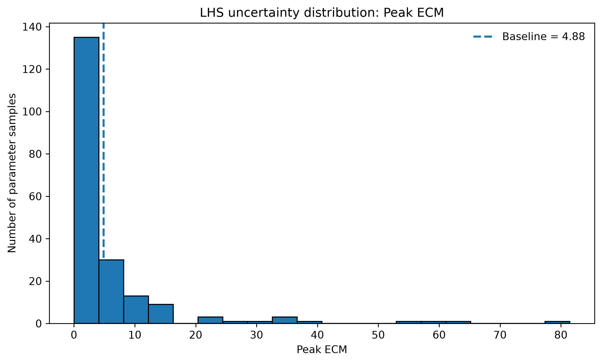

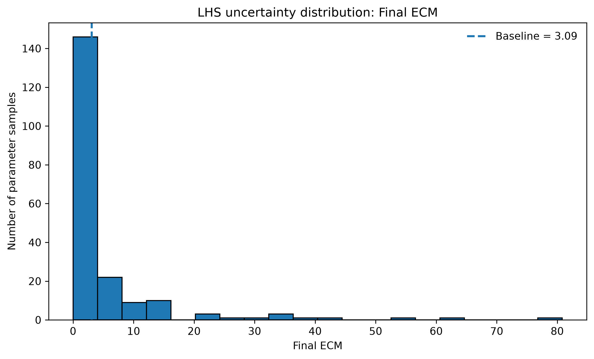

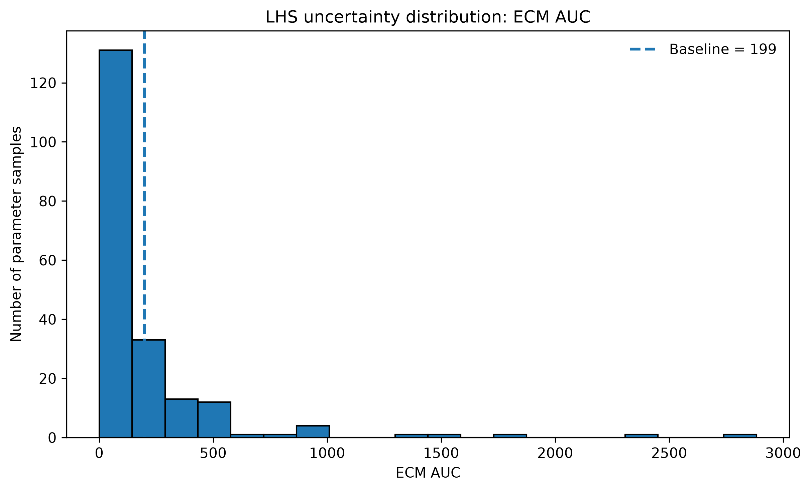

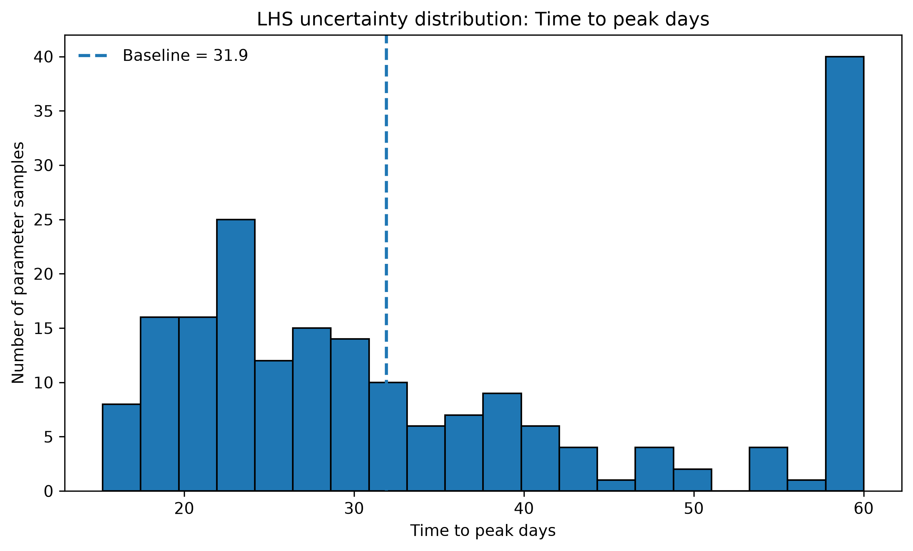

### Sampled equilibrium classification

Across the 200 sampled parameter sets:

- **167 sets** had $\mathcal{R}_{\mathrm{fb}}\leq1$ and a locally asymptotically stable DFE.
- **33 sets** had $\mathcal{R}_{\mathrm{fb}}>1$, with a unique locally asymptotically stable positive equilibrium. The DFE remained present but unstable in this regime.

A long-horizon simulation for one representative positive-equilibrium parameter set approached its calculated ECM equilibrium of approximately 12.152, with a relative difference of approximately 0.019%.

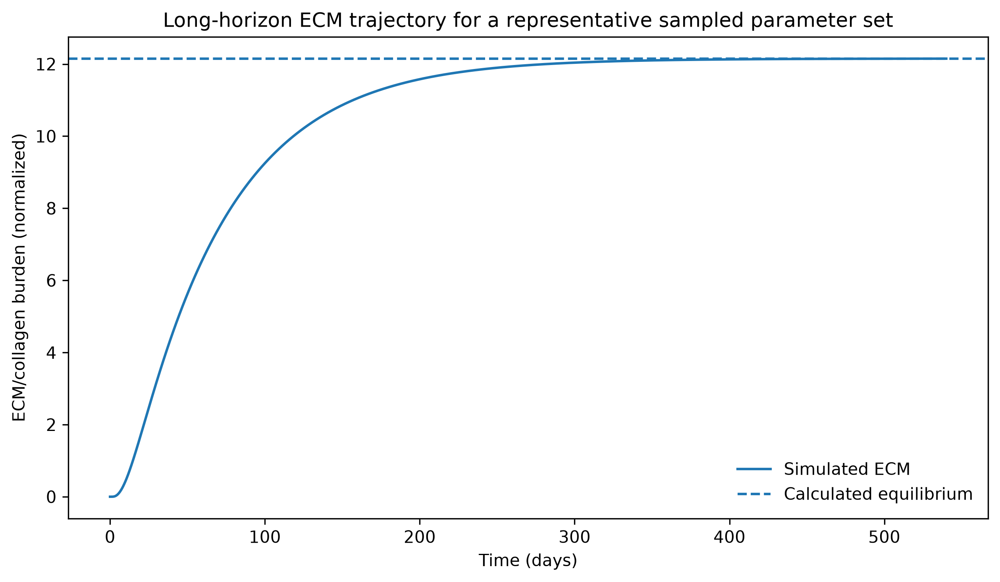

This comparison is a numerical convergence check for one representative parameter set.

## 6. Repository contents

```text
crohns-fibrostenosis-ode-model/
│
├── 01_model_setup.ipynb
├── figures/
├── results/
└── LICENSE
```

The Jupyter notebook contains the model implementation, parameter definitions, simulations, equilibrium calculations, sensitivity analysis, uncertainty analysis, and figure-generation procedures.

The `figures/` directory contains PNG and PDF outputs, while `results/` stores numerical summaries generated by the computational workflow.

## 7. Software and reproducibility

The analysis uses Python and the following scientific-computing libraries:

- NumPy
- SciPy
- pandas
- Matplotlib
- Jupyter Notebook / JupyterLab

Install the main dependencies using:

```bash
python -m pip install numpy scipy pandas matplotlib jupyterlab
```

To reproduce the analysis:

1. Clone or download the repository.
2. Install the dependencies.
3. Open `01_model_setup.ipynb` in JupyterLab or Jupyter Notebook.
4. Run the notebook sequentially from the first cell.

The LHS random seed is fixed at `20261110`. Exact parameter ranges and numerical solver settings should be taken from the notebook used to generate the results.

## 8. Scope and limitations

The model is a reduced mathematical representation of selected inflammatory and stromal processes. Its interpretation is subject to several limitations:

- State variables are normalized activities, not direct biological measurements.
- Parameter values and sampling ranges are exploratory assumptions.
- The two routes converge additively at $F$; no direct SUCNR1–TWIST1 molecular interaction is modeled.
- Spatial heterogeneity, collagen cross-linking, matrix metalloproteinases, and tissue mechanics are not explicitly represented.
- The ECM state is not equivalent to a validated histological or clinical fibrosis score.
- The model has not been fitted to patient-level data or clinically validated.

Accordingly, the results describe the mathematical behavior of the specified system under its stated assumptions.

## 9. License

This project is distributed under the MIT License. See the `LICENSE` file for details.
